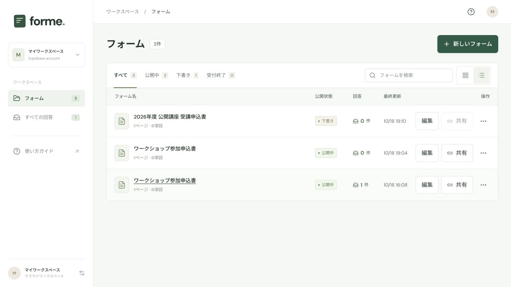

# Forme

**いつものPDFを、回答できるフォームに。**

PDFに入力欄を配置し、共有URLから回答を受け取り、日本語を含む記入済みPDFを出力するNext.js / TypeScriptアプリです。
作成者はメールの確認コードでログインし、回答者はログインせずに回答できます。

| 役割                   | 採用技術                                                   |
| ---------------------- | ---------------------------------------------------------- |
| アプリ配信・API        | Vercel / Next.js App Router / Node.js 24                   |
| 作成者の認証           | Supabase Auth（メールOTP、SSRセッション更新）              |
| フォーム・回答         | Supabase PostgreSQL（RLS、トランザクション、楽観的ロック） |
| 原本PDF・出力          | Supabase Storage（非公開バケット、署名付きURL）            |
| ドメイン・不正送信対策 | Cloudflare DNS / Turnstile                                 |
| PDF表示・出力          | PDF.js / pdf-lib / fontkit / 日本語フォント                |



## ローカルで動かす

Node.js 24、Dockerを使用します。この作品専用のSupabaseをポート56421〜56424で起動します。他のプロジェクトのSupabaseには接続しません。

```bash
npm ci
npm run supabase:start
npm run supabase:env
npm run dev
```

`supabase:env` はローカル専用の接続情報を `.env.local` に保存し、体験用アカウント `demo@example.com` を作ります。既存の `.env.local` は上書きしません。
アプリは通常3000番、使用中なら次のポートで起動します。この作業環境では [http://localhost:3001](http://localhost:3001) です。別のポートを使う場合は `.env.local` の `SITE_URL` とSupabase AuthのSite URLを合わせてください。

ログイン画面に `demo@example.com` を入力します。コードは外部メールに送信されず、[ローカル受信箱](http://127.0.0.1:56424) で確認できます。Supabase Studioは [http://127.0.0.1:56423](http://127.0.0.1:56423) です。

ローカルではTurnstileを省略できます。本番の公開時には必須です。ローカル接続情報をVercelへコピーしても外部から接続できません。

## 本番へ公開する

[本番接続・デプロイ手順](docs/deployment.md) に、Supabaseプロジェクトの作成からSMTP・Cloudflare・Vercelの設定まで記載しています。

```bash
cp .env.example .env.local
# 本番用の設定値を入力した環境で実行
npm run check:env
npm run build
npm start
```

Vercelのビルド時には必要な環境変数を検証します。実際の本番プロジェクト、DNS、SMTP、Turnstileのキーは別途用意します。コードのビルド成功だけで公開・メール配信の完了とはしません。

## 基本の使い方

1. メールの確認コードでログイン。
2. 「新しいフォーム」からPDFを選択、またはA4受講申込書のサンプルを作成。
3. 入力欄を移動・サイズ調整し、項目名・必須設定を編集。
4. プレビューでPDFへの反映を確認し、「公開する」で回答用URLを取得。
5. 回答者は共有URLから入力・送信。作成者は回答一覧、PDF、CSVで確認。

## 設計の見どころ

- **Vercelの転送サイズ制限に対応**：PDF本体は署名付きURLでStorageへ直接送信。出力もStorageに保存して短時間だけ有効なURLを返し、関数のレスポンスにPDFを含めません。
- **原本の不変性**：アップロード先は一時領域。サーバーが実サイズ・PDF構造・ページ数を確認し、別の非公開パスにコピーして登録します。原本の上書き権限はブラウザへ渡しません。
- **権限を二重に制御**：APIは検証済みのユーザーIDで所有者を確認。DBでもRLSを有効にし、匿名のテーブル閲覧・ブラウザからの直接書き換えを拒否します。秘密キーはサーバー専用です。
- **公開版の分離**：下書きの変更は公開中のPDFフォームへ即反映されません。回答には当時の定義と版番号を保存します。
- **競合・再送**：更新には改訂番号を使用。提出はPostgreSQLの行ロックと一意制約で受付状態・公開版・上限・重複をまとめて確認します。
- **座標と日本語PDF**：画面のズームに依存しない正規化座標。出力は日本語フォントを埋め込んだ編集可能なAcroForm。欠字・収まりきらない文章は受付前にエラーにします。
- **運用**：DBによる分散レート制限、フォーム数・原本容量・回答数の上限、回答一覧のページング、一時ファイルの回収、30日後の削除を実装しています。

詳細は [設計メモ](docs/architecture.md) と [運用手順](docs/operations.md) を参照してください。

## 検証

```bash
npm test
npm run build
npm run typecheck
npm run test:smoke
npm run format:check
# ローカルSupabase起動・.env.local設定後
npm run test:cloud
```

- `npm test`：PostgreSQL互換のPGliteで実際のアプリ用SQLを適用し、RLS、RPC権限、上限、公開版、再送、ページング、回収キューを検証。座標、値の検証、日本語PDF、CSRF、Turnstileのサーバー検証も含みます。
- `test:smoke`：ビルド後の本番HTTPサーバーで、未設定時の画面・管理画面の保護・CSRF・Cronの認証を確認します。
- `test:cloud`：専用のローカルSupabaseだけを対象に、実Auth・PostgREST・StorageとNext.jsを通して検証。4.5MBを超える直接アップロード／取得、別アカウントの拒否、同時再送、PDFの入力値などを確認します。終了時にテスト専用アカウントとデータを整理します。ホストされた本番プロジェクトには実行できません。

GitHub Actionsでも同じ検証を行います。ホストされたSupabase、Vercel、実ドメインでの最終確認は [デプロイ手順](docs/deployment.md) に分けています。

## 対応範囲と制限

- 1PDFは12MB・50ページ・100項目まで。パスワード付き、回転、特殊なCropBoxは拒否します。
- 1アカウントは50フォーム・登録原本合計100MB、1フォームは1000回答。削除待ちの原本も容量に含めます。一時ファイル・出力ファイルは別に期限管理します。
- 共有URLと回答控えURLは、そのURLを知っている人がアクセスする方式です。本人確認・宛先限定はありません。
- フォーム削除は即時に受付・閲覧を停止し、30日後に整理対象になります。復元UIはなく、期間内の復元は運用者が行います。
- 回答はフォームが維持されている間保存されます。公開運用では、この保存方針と問い合わせ先を利用者へ案内してください。
- OCR、自動入力欄検出、電子署名、共同編集、回答者へのメール通知は未実装です。
- 出力サイズを優先した日本語フォントのサブセット化には未対応です。DBバックアップにはStorage内のPDF本体が含まれないため、別々にバックアップします。

## 旧ローカル版のデータ

旧SQLiteは `.data/forme.sqlite` に残し、アプリの実行時には使いません。元データを上書きせず、対象ワークスペースと移行先の確認済みユーザーを明示する移行ツールを用意しています。手順は [デプロイ文書](docs/deployment.md#旧sqliteからの移行) を参照してください。

## ソースの入口

```text
src/app/                   管理・公開画面、API、ログイン
src/proxy.ts               SSR認証セッションの更新・キャッシュ抑止
src/lib/supabase/          ブラウザ・認証・サーバー専用クライアント
src/lib/forms.ts           Storage、所有者確認、保存・公開・回答取得
src/lib/pdf.ts             PDF検査・日本語AcroForm出力
src/lib/domain.ts          型、値の検証、正規化座標
supabase/migrations/       スキーマ、RLS、トランザクションRPC
scripts/                   起動検証・移行・ローカル環境構築
```

BIZ UDPゴシックとBIZ UD明朝はSIL Open Font Licenseです。ライセンスを `assets/fonts/` に同梱しています。
