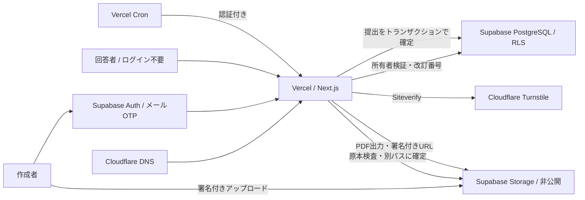

# Formeのクラウド構成



## 認証と権限

`@supabase/ssr` を用い、Proxyがセッション更新をレスポンスへ返します。認証を扱うレスポンスはキャッシュしません。管理ページはサーバーでユーザーを確認し、APIは改めて `getUser()` で検証します。Cookie内の未検証ユーザーIDを信用しません。匿名アカウント・メール未確認アカウントを管理者として受け付けません。

APIの所有者検索は `id AND owner_id AND deleted_at IS NULL` を使用します。DBは全アプリテーブルでRLSを有効化。認証済みユーザーの直接アクセスは自分の有効なフォーム・回答のSELECTに限定し、書き換え・内部テーブル・RPCはサーバー専用に制限します。

サーバーのSecret keyはRLSを迂回できるため、所有者チェックは省略できません。公開URLはランダムなトークンで公開版を探し、回答控えには独立したトークンを使います。

## アップロードの境界

1. 管理APIがログイン・上限・レートを確認し、DBにアップロード予約を作る。
2. 推測不能な一時パスだけの署名付きアップロード権限を返す。
3. ブラウザがStorageへ直接PDFを送る。VercelへPDF本体を送らない。
4. 完了APIが予約の所有者・期限、実バイト数、ページ数・回転・暗号化などを確認する。
5. サーバー専用の別パスへ原本をコピーし、PostgreSQLへ登録する。署名トークンを再利用しても登録後の原本には触れない。

原本は一度確定したら置換しません。確定処理は同じ予約IDで再試行できます。StorageとDBは一つのトランザクションにはできないので、書き込む前に回収キューへ登録し、DBの確定と同時に原本の回収予定を解除します。

## 公開と提出

入力欄は `page,x,y,width,height` の正規化座標で保存します。画面の拡大率は保存しません。

```text
pdfX = x × pageWidth
pdfY = (1 − y − height) × pageHeight
```

下書きの改訂番号で楽観的ロックを行い、公開操作で公開定義と版番号を固定します。回答検証では当該公開版の定義を使用し、日本語PDFを生成できることまで確認してから保存します。

`accept_submission` RPCはフォーム行をロックし、同一送信ID、受付状態、公開版、上限を確認します。`(form_id,idempotency_key)` の一意制約を設け、別インスタンスからの再送でも一件にします。同じIDで別内容なら409。保存済み回答には当時の定義を保持するため、後の編集で出力が変わりません。

## PDFの配信

原本は閲覧権限を確認した後の短時間署名URLへリダイレクトします。記入済みPDFは非公開の一時出力パスへ保存し、同様に短時間の署名URLを渡します。関数レスポンスはJSONまたはリダイレクトで、PDFのサイズに依存しません。

ファイル名・日本語フォント・出力のAcroFormを維持します。署名URLの有効期限は60秒で、再取得時は再度APIで権限確認します。ただし発行済みURLは有効期限まで使えるため、削除の直後に即時失効する保証はありません。

## 上限と一覧

アカウント行のロックで原本容量・フォーム数・予約数を確認します。原本100MB・50フォーム・未完了予約5件、1フォーム1000回答に制限しています。一時アップロードと出力の実使用量は登録原本の上限とは別で、レート制限と期限回収で管理します。

レート制限はPostgreSQLの原子的なUPSERTで共有します。Vercelではプラットフォームが上書きする `x-vercel-forwarded-for` を使い、任意の `x-forwarded-for` や `cf-connecting-ip` は信用しません。Vercel外の開発では共通のローカル枠です。

回答一覧は10件ずつDBで検索・ページング。CSVは出力開始時刻を固定し、その時刻までの回答をページ単位で取得します。

## 削除と回収

フォーム削除で `deleted_at` と受付停止を保存し、管理・公開・回答控えの全ての入口で除外します。30日後にDB削除と原本の回収予約を行います。公開中のフォームの回答を勝手に期限削除する処理は入れていません。

Vercel Cronが毎日04:00 JSTに認証付きで実行されます。一時アップロードは署名トークンの寿命を過ぎた3時間後から、出力は24時間後から回収対象になります。処理は一回500件で、失敗したStorage削除はキューを残して次に再試行します。規模が増えたら実行頻度とバッチ数を運用で増やします。
